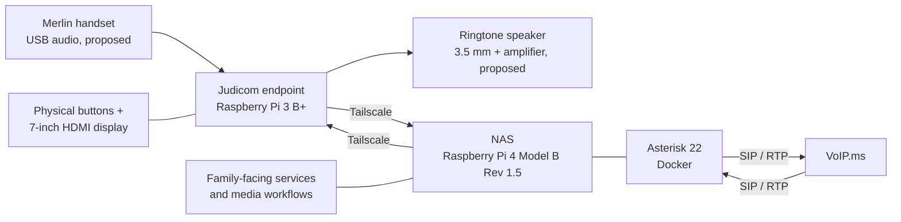

# Judicom Architecture

Judicom is a simple, physical communications device intended for a person who may find conventional smartphones difficult to use. A Raspberry Pi endpoint provides a display, large physical buttons, and telephone-style audio. A separate Raspberry Pi NAS hosts supporting services and connects the endpoint to family members and a SIP telephone provider.

## System overview

The endpoint is designed to communicate with the NAS over a private network. The NAS hosts Asterisk and other application/media services. VoIP.ms provides external SIP connectivity; inbound calling is not yet documented as end-to-end working.

## Components

| Component | Platform / function | Status |
|---|---|---|
| Judicom endpoint | Raspberry Pi 3 Model B+; Python / Pygame; 7-inch 1024×600 HDMI display; physical buttons | Target platform; integration ongoing |
| Handset audio | Merlin handset via USB audio interface | Proposed; handset electrical characteristics TBD |
| Ringtone | Separate speaker driven by 3.5 mm output through an LM386 amplifier | Proposed |
| NAS | Raspberry Pi 4 Model B Rev 1.5; Debian Linux, Docker, storage, network services | Existing; configuration to inventory |
| Asterisk | Asterisk 22 in Docker on NAS | Running; VoIP.ms registration previously confirmed |
| SIP service | VoIP.ms, Chicago server | Registration confirmed; inbound call path needs validation |
| Private networking | Tailscale between endpoint and NAS; SSH administration | In use / verify current routing and access rules |
| Family/media workflows | Family-facing messages and media services hosted or mediated by NAS | Partially implemented / evolving |

## Communication and security

- **Endpoint ↔ NAS:** private IP connectivity, preferably over Tailscale; no need to expose the endpoint directly to the internet.
- **NAS ↔ VoIP.ms:** Asterisk uses SIP signaling and RTP media. Confirm the actual ports, NAT traversal, and inbound media behavior against the live configuration.
- **Firewall:** NAS uses `nftables` rules for SIP access. Preserve the live rules and their persistence mechanism in deployment documentation, not here.
- **Secrets:** SIP credentials, tokens, private keys, and other secrets must not be committed to Git. Check exported configurations before adding them.

## Current state and open decisions

**Established:** Python/Pygame endpoint work on Raspberry Pi hardware; NAS-hosted Asterisk 22; successful VoIP.ms registration; Tailscale connectivity in the project environment.

**Still to validate:** complete inbound SIP/RTP call; handset microphone/receiver electronics; USB audio device selection; hook/button interactions; ringtone output; device boot and recovery behavior.

**Deferred:** video calling and optional migration to Orange Pi.

## Related documentation

- `README.md` — purpose and quick start
- `docs/DEPLOYMENT.md` — installation, services, Asterisk, Docker, and firewall configuration
- `HARDWARE.md` — wiring, pin assignments, handset tests, and enclosure
- `DECISION.md` — significant design choices and their rationale

> **Documentation rule:** This file describes the architecture. Actual configuration files and repeatable deployment steps belong alongside it in version control, with secrets excluded.
